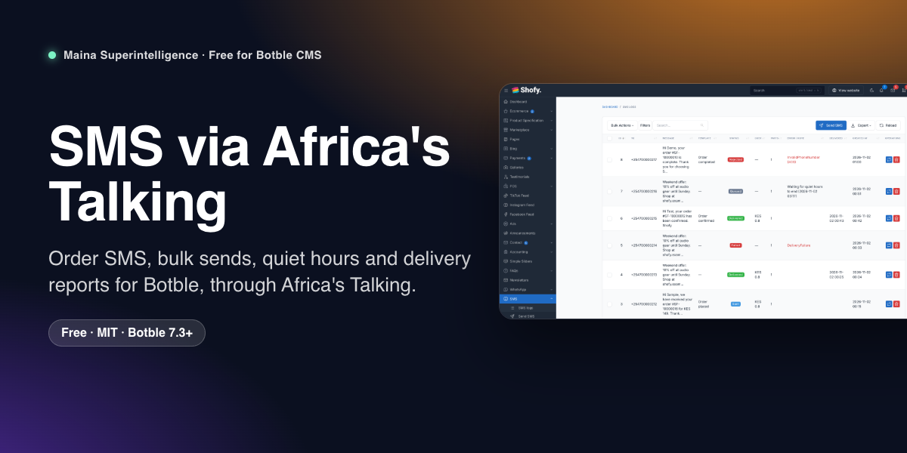
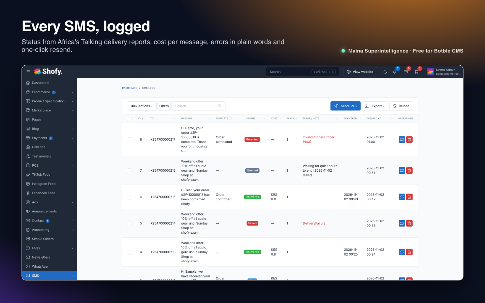
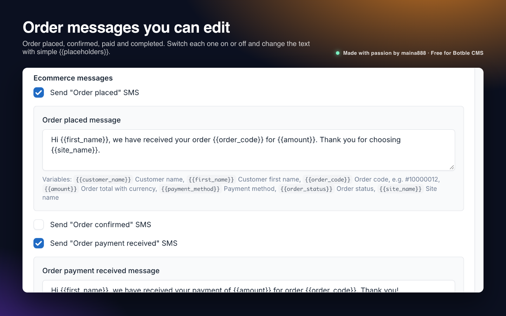
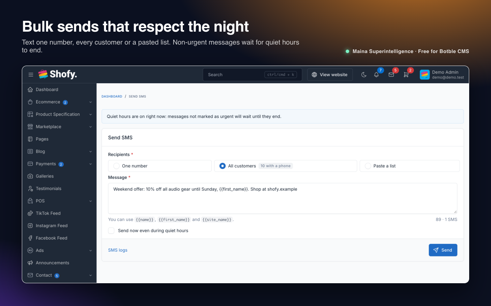
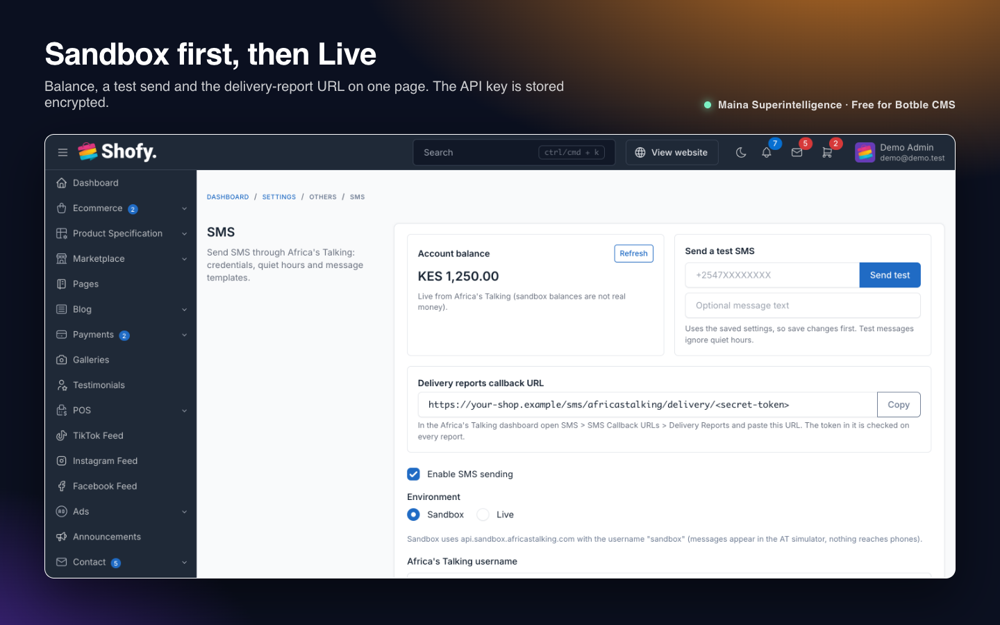

Send SMS from your Botble site through Africa's Talking: order notifications with text you can edit, bulk messages to customers, and a log of every message with its delivery status. Quiet hours hold non-urgent messages overnight, and other plugins can send SMS with one line of code.

**Free and open source** by **Maina 888** · Maina Superintelligence Ltd

**Version:** 1.1.0 · **Requires:** Botble CMS core 7.3.0+, PHP 8.2+ · **License:** MIT

## Features

- **Order notifications** for Botble e-commerce: *Order placed*, *Order confirmed*, *Order payment received* and *Order completed*. Switch each one on or off and edit its text with `{{placeholders}}`. Each order gets each message once, and an order already paid online gets one "payment received" SMS instead of two messages.
- **Send SMS page:** one number, every customer with a phone number, or a pasted list (CSV or one number per line). Personalise with `{{name}}`, `{{first_name}}` and `{{site_name}}`, with a live character and SMS-part counter.
- **Quiet hours:** non-urgent messages (bulk sends, reminders) created at night wait until the window ends, in your timezone. Order messages are urgent and go out at once.
- **Delivery reports:** paste one URL into Africa's Talking and each message moves from *Sent* to *Delivered*, *Failed* or *Rejected*, with the reason.
- **SMS logs** with cost, number of parts, errors in plain words, filters, export, delete and one-click **Resend**.
- **Settings page** with Sandbox/Live switch, account balance, a test send and the delivery-report URL. The API key is stored encrypted and never shown again.
- **Dashboard widget:** sent, failed and queued today, cost and balance.
- **Phone numbers** are normalised to international format (`+<country code><number>`), using a default country code or your store country. Invalid numbers are logged as *Rejected* instead of being sent.
- **Retries:** on a real queue, network and gateway errors are retried four times (1, 5 and 15 minutes apart).
- **Developer API:** `sms_send()`, `sms_send_template()`, an `sms_templates` filter to add message types, an `sms_audiences` filter to add recipient groups, and `SmsSent` / `SmsDelivered` / `SmsFailed` events. Used by the WhatsApp Business Cloud API plugin for its SMS fallback.

## Screenshots

| SMS logs | Order messages |
| --- | --- |
|  |  |
|  |  |

## Requirements

- Botble CMS core 7.3.0 or newer, PHP 8.2 or newer.
- An [Africa's Talking](https://africastalking.com) account (the free sandbox is enough to try it).
- Optional: the **Ecommerce** plugin for order messages and the *All customers* recipient group.
- Recommended: a queue worker and the Laravel scheduler (see below). Without a queue worker messages are sent during the request.

## Installation

### From the Botble Marketplace (recommended)

1. Go to **Admin → Plugins → Add new**.
2. Search for **SMS via Africa's Talking**, click **Install**, then **Activate**.

Updates appear in **Admin → Plugins** whenever a new version is released.

### From a release zip

1. Download `sms-x.y.z.zip` from the [latest release](https://github.com/Themaina/maina-sms/releases/latest).
2. Go to **Admin → Plugins → Add new → Upload**, pick the zip, then **Activate**.

### Manually

1. Copy the `sms` folder to `platform/plugins/sms`.
2. Run `php artisan cms:plugin:activate sms`. Activation creates the `sms_logs` table.

### Production setup

- Scheduler (releases messages held by quiet hours): `* * * * * php /path/to/site/artisan schedule:run >> /dev/null 2>&1`
- Queue worker (sends in the background and retries): `php artisan queue:work`. On the `sync` queue driver messages are sent straight away and a failure is final (you can resend it from the logs).

## Configuration

Open **Admin → Settings → Others → SMS** (also under **SMS → SMS** in the menu).

| Setting | What it does |
| --- | --- |
| Enable SMS sending | Master switch. When off, messages are logged as failed instead of sent. |
| Environment | *Sandbox* uses `api.sandbox.africastalking.com` with the username `sandbox`; messages appear in the Africa's Talking simulator and never reach phones. *Live* sends real SMS. |
| Africa's Talking username | Your app username (ignored in Sandbox). |
| API key | From the Africa's Talking dashboard. Stored encrypted with your app key; leave blank to keep the saved key. |
| Sender ID or shortcode | Optional. Must be approved on your account; blank uses the shared sender. |
| Default country code | Added to local numbers such as `07XX XXX XXX`, e.g. `254` (Kenya), `256` (Uganda), `234` (Nigeria). Empty uses your store country if Africa's Talking serves it; otherwise numbers must be written in international format. |
| Quiet hours, start, end, timezone | Window in which non-urgent messages wait (default 21:00 to 07:00). Empty timezone uses the site timezone. |
| Order messages | A switch and an editable text for each order message. Variables: `{{customer_name}}`, `{{first_name}}`, `{{order_code}}`, `{{amount}}`, `{{payment_method}}`, `{{order_status}}`, `{{site_name}}`, `{{site_url}}`. |

**Delivery reports:** copy the *Delivery reports callback URL* from the settings page into the Africa's Talking dashboard under *SMS → SMS Callback URLs → Delivery Reports*.

## Usage

### Admin pages

| Page | Purpose |
| --- | --- |
| **SMS → SMS logs** | Every message with status, cost, parts and errors. Resend, delete, filter, export. |
| **SMS → Send SMS** | Send to one number, all customers, or a pasted list. |
| **Settings → Others → SMS** | Credentials, balance, test send, quiet hours and order messages. |

Permissions: *SMS* (logs), *Resend*, *Delete*, *Send SMS*, and *SMS* under *Settings → Others*.

### Routes

| URL | Purpose |
| --- | --- |
| `POST /sms/africastalking/delivery/{token}` | Africa's Talking delivery reports. The token is derived from your app key; any other value gets 403. |

### Commands

| Command | What it does |
| --- | --- |
| `php artisan sms:send-scheduled` | Sends messages whose quiet-hours wait is over. Scheduled every minute. |

### From your own code

```php
// One number -> SmsLog; an array -> Collection of SmsLog. Queued, respects quiet hours unless urgent.
sms_send('+2547XXXXXXXX', 'Your order is ready for pickup.', ['related' => $order], urgent: true);

// A registered template with variables. Returns null when SMS or that template is switched off.
sms_send_template($phone, 'order_placed', ['first_name' => 'Demo', 'order_code' => '#10000012', 'amount' => 'KES 1,500']);

$sms = app(\MainaSuperintelligence\Sms\Services\SmsService::class);
$sms->normalisePhone('07XX XXX XXX'); // '+2547XXXXXXXX' or null
$sms->balance();                      // e.g. 'KES 1250.0000' (cached for five minutes)
```

Register your own message type; it gets a switch and an editable text box on the settings page:

```php
add_filter('sms_templates', function (array $templates): array {
    $templates['order_shipped'] = [
        'label' => 'Order shipped',
        'group' => 'Shipping',
        'default' => 'Hi {{first_name}}, order {{order_code}} is on its way. {{site_name}}',
        'variables' => ['first_name' => 'First name', 'order_code' => 'Order code'],
        'urgent' => true,   // false = waits for quiet hours
        'enabled' => true,  // default state of the switch
    ];

    return $templates;
});
```

Add a recipient group to the *Send SMS* page:

```php
add_filter('sms_audiences', function (array $audiences): array {
    $audiences['vip'] = [
        'label' => 'VIP customers',
        'recipients' => fn () => collect([['phone' => '+2547XXXXXXXX', 'name' => 'Demo Customer']]),
    ];

    return $audiences;
});
```

Events: `MainaSuperintelligence\Sms\Events\SmsSent`, `SmsDelivered` and `SmsFailed` (each with `$log`; `SmsFailed` also has `$reason`).

## How it works

Every message is first written to `sms_logs` with status *Queued*. Messages created during quiet hours get a `send_after` time and are released by `sms:send-scheduled`; the rest are dispatched to the queue at once. The job calls Africa's Talking's messaging API, stores the message ID, cost and status, and retries transient errors. Delivery reports find the log by message ID and update it to *Delivered*, *Failed* or *Rejected*. Order messages listen to Botble's order events and never interrupt checkout: errors are logged, not thrown.

## Troubleshooting

| Problem | Fix |
| --- | --- |
| Messages are logged as *Failed: SMS sending is disabled* | Turn on *Enable SMS sending*. |
| Messages stay *Queued* | They are waiting for quiet hours (see the note in the log), or no queue worker is running. Check cron runs `schedule:run` and that `queue:work` is running. |
| *Rejected: Invalid phone number* | Set the *Default country code*, or store numbers in international format. |
| Status never becomes *Delivered* | Add the delivery-report URL in the Africa's Talking dashboard; your site must be reachable from the internet. |
| Balance shows "unavailable" | Check the username, API key and environment. Sandbox keys don't work in Live. |
| Nothing reaches phones in Sandbox | That's expected; sandbox messages appear in the Africa's Talking simulator. |

## Uninstall

Remove the plugin from **Admin → Plugins**. The `sms_logs` table and all `sms_*` settings are deleted.

## Development

Unit tests (phone numbers, quiet hours, template rendering, SMS parts) only need the Botble project's vendor directory:

```bash
vendor/bin/phpunit -c platform/plugins/sms/phpunit.xml.dist
```

Feature tests boot the whole application against the database in `.env`, run each test in a rolled-back transaction and fake Africa's Talking. Run them on a development copy only:

```bash
vendor/bin/phpunit -c platform/plugins/sms/phpunit.xml.dist --testsuite=Feature
```

## File structure

```
sms/
├── plugin.json
├── config/permissions.php
├── database/migrations/
├── helpers/helpers.php
├── routes/web.php
├── resources/{lang/en, views}
├── src/{Commands, Enums, Events, Forms, Http, Jobs, Listeners, Models, Providers, Services, Supports, Tables, Plugin.php}
├── tests/{Unit, Feature}
└── art/            (marketplace images, not shipped in the zip)
```

## Support

- Questions and bug reports: [GitHub issues](https://github.com/Themaina/maina-sms/issues)
- Security problems: see [SECURITY.md](https://github.com/Themaina/maina-sms/blob/main/SECURITY.md)
- Changes in each version: [CHANGELOG.md](https://github.com/Themaina/maina-sms/blob/main/CHANGELOG.md)

Africa's Talking is a trademark of Africa's Talking Ltd. This plugin is not made or endorsed by Africa's Talking.

## License

Free and open source under the [MIT License](https://github.com/Themaina/maina-sms/blob/main/LICENSE). © 2026 Maina Superintelligence Ltd. Made by Maina 888.
